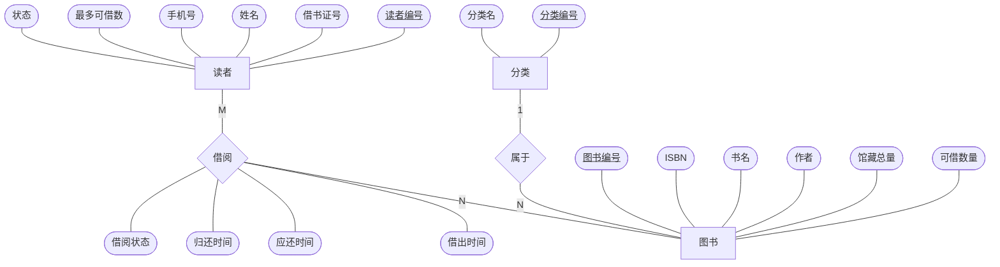

# 图书借阅管理系统（library-crud）

目标：用一个完整的小系统把 Java 后端 CRUD 的每一环走通——建表 → 写 SQL → 业务校验 → 接口 → 页面 → 测试 → Git。

技术栈：Spring Boot 3.2 + MyBatis（手写 XML SQL）+ MySQL 8；前端原生 HTML + fetch；测试用 H2 内存库。

---

## 一、工作流程主线：一次请求从头到尾怎么走

以"借书"为例，所有接口都走同一条线：

```
页面点"借出"
  → fetch POST /api/borrows  {bookId, readerId, days}          (index.html 的 api())
  → Controller：JSON 反序列化成 BorrowDTO + @Valid 校验参数      (BorrowController)
  → Service：业务规则校验 → 改库（一个事务）                      (BorrowService)
  → Mapper：接口方法 → 找到 XML 里同名 SQL → 执行                 (BorrowRecordMapper.xml)
  → 返回 Result{code, msg, data}；任何一步抛异常 → GlobalExceptionHandler 翻译成 Result
  → 页面判断 code：200 刷新列表，否则弹出 msg
```

每一层只做一件事：Controller 收参数/回结果，Service 判断"能不能做"，Mapper 只执行 SQL。

---

## 二、系统功能模块

| 模块 | 功能 | 接口 |
|---|---|---|
| 分类管理 | 列表、新增、修改、删除（有书不能删） | `GET/POST /api/categories`，`PUT/DELETE /api/categories/{id}` |
| 图书管理 | 分页+书名模糊+分类筛选、详情、新增、修改（总量不能少于借出数）、删除（有未还不能删） | `GET/POST /api/books`，`GET/PUT/DELETE /api/books/{id}` |
| 读者管理 | 分页+姓名/证号筛选、新增、修改、冻结/解冻、删除（有未还不能删） | `GET/POST /api/readers`，`GET/PUT/DELETE /api/readers/{id}`，`PATCH /api/readers/{id}/status?status=0` |
| 借阅管理 | 借书、还书、借阅记录分页（显示是否逾期） | `GET/POST /api/borrows`，`PUT /api/borrows/{id}/return` |

---

## 三、数据库设计

按四个阶段进行，每一阶段的产出是下一阶段的输入：

```
需求分析 ──→ 概念结构设计 ──→ 逻辑结构设计 ──→ 物理结构设计
(要存什么、    (E-R 图：实体、    (E-R 图转成关系模式，   (落到 MySQL：表名、
 要做什么、     属性、联系，       范式检查，              列类型、约束、
 有哪些规则)    与具体数据库无关)  完整性约束)             存储引擎、字符集)
```

建表脚本：[schema.sql](src/main/resources/schema.sql)，初始数据：[data.sql](src/main/resources/data.sql)（启动时自动执行，可重复执行）。

### 3.1 需求分析

**① 处理需求：系统要做哪些事，每件事要用到哪些数据**

| 业务处理 | 使用者 | 读取的数据 | 写入的数据 |
|---|---|---|---|
| 维护分类 | 管理员 | 分类名 | 分类 |
| 新书入库 / 修改图书 | 管理员 | 分类、ISBN | 图书（ISBN、书名、作者、所属分类、馆藏总量） |
| 办理 / 修改借书证 | 管理员 | 借书证号 | 读者（证号、姓名、手机号、最多可借数） |
| 冻结 / 解冻借书证 | 管理员 | 读者 | 读者状态 |
| 借书 | 管理员替读者办理 | 读者状态、读者未还数、读者逾期数、图书可借数量 | 借阅（谁、哪本、借出时间、应还时间）；图书可借数量 −1 |
| 还书 | 管理员替读者办理 | 借阅状态 | 借阅（归还时间、状态）；图书可借数量 +1 |
| 查询借阅记录 | 管理员 | 借阅、图书书名、读者姓名 | — |

**② 信息需求：要长期保存的数据项**

| 对象 | 数据项 |
|---|---|
| 分类 | 分类编号、分类名 |
| 图书 | 图书编号、ISBN、书名、作者、馆藏总量、可借数量 |
| 读者 | 读者编号、借书证号、姓名、手机号、最多可借数、状态（正常 / 冻结） |
| 借阅 | 哪个读者、哪本图书、借出时间、应还时间、归还时间、状态（借出中 / 已归还） |

**③ 完整性需求：数据必须满足的业务规则**

1. 分类名、ISBN、借书证号各自不能重复；读者姓名可以重复。
2. 每本图书必须属于一个已存在的分类。
3. 0 ≤ 可借数量 ≤ 馆藏总量。
4. 读者被冻结、有逾期未还、未还数已达上限、同一本书正在借着 —— 任一成立都不能借书。
5. 一条借阅只能归还一次；借阅记录只增不删，作为历史保留。
6. 还有书没还的读者和图书不能删除；还有图书的分类不能删除。

### 3.2 概念结构设计（E-R 图）

从需求分析里找出三类东西：

- **实体**：能独立存在、需要单独管理的对象 → 分类、图书、读者。
- **联系**：实体之间发生的关系 → 图书"属于"分类；读者"借阅"图书。
- **属性**：描述实体或联系的数据项。注意借出时间、应还时间、归还时间、状态**既不属于读者也不属于图书**，
  它们描述的是"某个读者借某本书"这件事，所以是**借阅联系的属性**。

联系的类型：

| 联系 | 类型 | 判断方法 |
|---|---|---|
| 分类 —属于— 图书 | 1 : N | 一个分类下有多本书；一本书只属于一个分类 |
| 读者 —借阅— 图书 | M : N | 一个读者借过多本书；一本书被多个读者借过 |

E-R 图（矩形 = 实体，菱形 = 联系，椭圆 = 属性，下划线 = 码；在 GitHub 上会渲染成图，VS Code 预览需装 Mermaid 插件）：



### 3.3 逻辑结构设计（E-R 图 → 关系模式）

**① 转换规则与结果**（下划线 = 主码，*斜体* = 外码）

| E-R 图中的成分 | 转换规则 | 得到的关系模式 |
|---|---|---|
| 实体 分类 | 一个实体转成一个关系 | 分类(<u>分类编号</u>, 分类名) |
| 实体 读者 | 同上 | 读者(<u>读者编号</u>, 借书证号, 姓名, 手机号, 最多可借数, 状态) |
| 实体 图书 + 1:N 联系"属于" | 1:N 联系不单独成表，并入 N 端，把 1 端的主码加进来作外码 | 图书(<u>图书编号</u>, ISBN, 书名, 作者, *分类编号*, 馆藏总量, 可借数量) |
| M:N 联系"借阅" | M:N 联系必须单独成为一个关系，包含两端实体的主码 + 联系自身的属性 | 借阅(<u>借阅编号</u>, *读者编号*, *图书编号*, 借出时间, 应还时间, 归还时间, 状态) |

借阅关系的主码为什么不是规则默认的 (读者编号, 图书编号)：同一个读者可以借了还、还了再借同一本书，
这个组合会重复出现，不能唯一标识一行，所以另加一个**借阅编号**作主码。

**② 范式检查**

- 四个关系的属性都是不可再分的单一值 → 满足 1NF。
- 分类、图书、读者、借阅的主码都是单个属性，不存在"只依赖主码一部分"的情况 → 满足 2NF。
- 没有非主属性通过别的非主属性间接依赖主码 → 满足 3NF。反例：如果把"分类名"也放进图书关系，
  就有 图书编号 → 分类编号 → 分类名 的传递依赖，改一个分类名要改所有该分类的图书。所以图书只存分类编号，查列表时再联表取分类名。
- **一处有意的冗余**：可借数量 = 馆藏总量 − 该书未还的借阅数，本可以从借阅关系算出来。保留它是为了
  借书时不用每次统计借阅表，并且能用一条带条件的 UPDATE 同时完成"判断有没有库存"和"扣减"（见 4.1）。
  代价是借书、还书时必须同步修改它，靠事务保证（见 4.5）。

**③ 完整性约束**（对应需求分析第 ③ 条）

| 约束类别 | 内容 | 本项目的实现 |
|---|---|---|
| 实体完整性 | 每个关系的主码非空且唯一 | 四张表的 `id` 都是自增主键 |
| 参照完整性 | 图书.分类编号 参照 分类；借阅.读者编号 参照 读者；借阅.图书编号 参照 图书 | **不建物理外键**，在 Service 里校验（`categoryService.getOrThrow`、删除前 COUNT），原因见 4.5 |
| 用户定义完整性 | 必填项非空；分类名 / ISBN / 证号唯一；0 ≤ 可借数量 ≤ 馆藏总量；状态只能取 0 或 1 | NOT NULL、UNIQUE 约束；数量和状态规则在 SQL 条件和 Service 里保证 |

### 3.4 物理结构设计

**① 环境选择**：MySQL 8，InnoDB 引擎（支持事务和行锁，借书的事务依赖它），字符集 utf8mb4（MySQL 的 utf8 存不了 emoji 和部分生僻字）。

**② 命名映射**：关系名、属性名转成英文小写下划线 —— 分类 → `category`，图书 → `book`，读者 → `reader`，借阅 → `borrow_record`；
另给每张表加 `create_time`（记录创建时间，由数据库自动填）。

**③ 逐表的列类型与约束**

公共约定：编号统一用 BIGINT 自增（不用担心 INT 约 21 亿的上限）；时间统一用 DATETIME（TIMESTAMP 只能到 2038 年，且会按会话时区转换）。

**category 图书分类**

| 列 | 类型 | 约束 | 为什么 |
|---|---|---|---|
| id | BIGINT 自增 | 主键 | 自增保证新行按顺序追加到末尾，插入时不用挪动已有数据 |
| name | VARCHAR(50) | NOT NULL，UNIQUE | 分类名不能重复；UNIQUE 是并发下的最后防线（见 4.5） |
| create_time | DATETIME | 默认 CURRENT_TIMESTAMP | 由数据库填，Java 不用管 |

**book 图书**

| 列 | 类型 | 约束 | 为什么 |
|---|---|---|---|
| isbn | VARCHAR(20) | NOT NULL，UNIQUE | 用业务编号判断"是不是同一本书"；不用 BIGINT 是因为 ISBN 可能带 `-`、`X`，且不参与计算 |
| title | VARCHAR(100) | NOT NULL | 列表要按书名模糊搜 |
| author | VARCHAR(50) | 可空 | 有的书作者不详，允许为空 |
| category_id | BIGINT | NOT NULL | 外码，指向分类；必须有分类（查询用的索引见 4.4） |
| total_stock | INT | NOT NULL 默认 0 | 馆藏总量，只在管理员修改图书时变 |
| available_stock | INT | NOT NULL 默认 0 | 可借数量，只在借书（-1）还书（+1）时变 |
| create_time / update_time | DATETIME | update_time 带 ON UPDATE | 每次 UPDATE 由数据库自动刷新修改时间 |

已借出数量不单独建列：已借出 = total_stock − available_stock，再存一列就会出现三个数对不上的情况。

**reader 读者**

| 列 | 类型 | 约束 | 为什么 |
|---|---|---|---|
| card_no | VARCHAR(20) | NOT NULL，UNIQUE | 借书证号，业务上的唯一身份 |
| name | VARCHAR(50) | NOT NULL | 允许重名，所以**不**加 UNIQUE |
| phone | VARCHAR(11) | 可空 | 手机号用字符串：不做加减运算，且数字类型会丢掉开头的 0 |
| max_borrow | INT | NOT NULL 默认 5 | 每个读者的借书上限可以不同（如老师 10 本、学生 5 本），所以放在读者身上而不是写死在代码里 |
| status | TINYINT | NOT NULL 默认 1 | 1 正常 0 冻结；TINYINT 占 1 字节，加新状态只改代码不改表（ENUM 加值要 ALTER TABLE） |

**borrow_record 借阅记录**

| 列 | 类型 | 约束 | 为什么 |
|---|---|---|---|
| book_id / reader_id | BIGINT | NOT NULL | 谁借了哪本 |
| borrow_time | DATETIME | NOT NULL | 借出时间，由 Java 传入（和 due_time 用同一个 now 计算，保证正好相差 N 天） |
| due_time | DATETIME | NOT NULL | 应还时间；借书时就算好存下，因为每次借的天数可以不同 |
| return_time | DATETIME | 可空 | 没还就是 NULL；还书时填 NOW() |
| status | TINYINT | NOT NULL 默认 0 | 0 借出中 1 已归还 |

- 有了 return_time 为什么还要 status？`return_time IS NULL` 也能表示没还，但 `IS NULL` 不如 `status = 0` 直观，
  且以后加"丢失""损坏"等状态时 return_time 表达不了。
- **"是否逾期"不存列**：逾期取决于"现在几点"，今天没逾期明天就逾期了，存下来就会过时，要靠定时任务刷新。
  所以查询时当场算：`status = 0 AND due_time < NOW()`。
- 借阅记录**只增不删**，还书只是改状态，所有历史都保留。

---

## 四、核心业务流程

### 4.1 借书（改两张表，一个事务）

```
读者存在？→ 未冻结？→ 无逾期？→ 未还数 < max_borrow？
  → 图书存在？→ 这本没在借着？
  → 扣库存  UPDATE book SET available_stock = available_stock - 1 WHERE id = ? AND available_stock > 0
        影响 0 行 → "库存不足"
  → 插入借阅记录
任何一步抛 BusinessException → @Transactional 回滚已扣的库存
```

关键点：扣库存不能"先 SELECT 判断再 UPDATE"，两个人同时借最后一本会超借；
把判断写进 UPDATE 的 WHERE，靠 InnoDB 行锁串行化（`ConcurrentStockTest` 用 10 个线程验证只成功 1 次）。

### 4.2 还书

```
记录存在？→ 标记归还 UPDATE ... SET status = 1 WHERE id = ? AND status = 0   影响 0 行 → "请勿重复操作"
          → 加库存   UPDATE ... WHERE id = ? AND available_stock < total_stock
```

先标记再加库存：标记这一步只有一个请求能成功，保证库存只被加一次。

### 4.3 修改馆藏总量

新可借 = 旧可借 + (新总量 − 旧总量)，结果 < 0 说明还有书没还回来，拒绝。计算与判断放在同一条 UPDATE 里（见 `BookMapper.xml` 的 `update` 注释，含 SET 顺序的坑）。

### 4.4 索引：由业务查询决定

表结构定下来之后，索引取决于业务实际要跑哪些查询。把 Mapper 里每条 SQL 的 WHERE 列出来，看谁需要：

| SQL（所在方法） | WHERE 条件 | 用到的索引 |
|---|---|---|
| 按名字查分类 `selectByName` | `name = ?` | `uk_category_name` |
| 按 ISBN 查书 `selectByIsbn` | `isbn = ?` | `uk_book_isbn` |
| 删分类前数书 `countByCategoryId` | `category_id = ?` | `idx_book_category`（COUNT 只读索引树，不回表） |
| 图书分页按分类筛 `selectPage` | `category_id = ?` | `idx_book_category` |
| 图书分页按书名搜 `selectPage` | `title LIKE '%x%'` | **用不上索引**（前面有 `%`，B+ 树不知道从哪开始找），数据量小时全表扫描可接受，量大要换全文索引或 ES |
| 按证号查读者 `selectByCardNo` | `card_no = ?` | `uk_reader_card_no` |
| 读者未还几本 `countUnreturnedByReader` | `reader_id = ? AND status = 0` | `idx_borrow_reader_status` 两列全用上 |
| 读者有无逾期 `countOverdueByReader` | `reader_id = ? AND status = 0 AND due_time < NOW()` | 同上，先用索引定位到该读者未还的几行，再逐行判断 due_time |
| 是否已借同一本 `countUnreturned` | `reader_id = ? AND status = 0 AND book_id = ?` | 同上 |
| 图书有无未还 `countUnreturnedByBook` | `book_id = ? AND status = 0` | `idx_borrow_book` |
| 借阅记录按读者筛 `selectPage` | `reader_id = ?` | `idx_borrow_reader_status`（最左前缀：只用第一列也能命中） |

为什么是 `(reader_id, status)` 联合索引而不是两个单列索引：
- 借书时这三条统计 SQL 每次都要跑，条件都是"某读者 + 未还"。联合索引按 reader_id 排好序，同一读者内再按 status 排序，能直接定位到"张三的未还记录"这一小段。
- 顺序不能反过来：`status` 只有 0/1 两个值，放前面区分度太低；而且 `(status, reader_id)` 无法服务"只按读者查"的分页筛选。
- 单独给 status 建索引没有意义：一半数据是 0、一半是 1，走索引还要回表，优化器通常直接选全表扫描。

### 4.5 数据一致性：每条规则由谁保证

不建物理外键后，"数据不出错"由四层分担，越往下越可靠：

| 必须成立的规则 | Service 校验（友好提示） | 条件 UPDATE（原子判断） | 事务（同成同败） | 数据库约束（最后防线） |
|---|---|---|---|---|
| 分类名 / ISBN / 证号不重复 | 先查有没有同名 | | | UNIQUE 索引 |
| 可借数量不小于 0（不超借） | | `WHERE available_stock > 0` | | |
| 可借数量不超过总量（不重复加） | | `WHERE available_stock < total_stock` | | |
| 改总量后可借不为负 | | `WHERE available_stock + (新总量 - total_stock) >= 0` | | |
| 一条借阅只能还一次 | | `WHERE status = 0` | | |
| 扣库存和写借阅记录同时成功 | | | `@Transactional` | |
| 书必须属于存在的分类 | `categoryService.getOrThrow` | | | （外键可保证，本项目不建） |
| 有书的分类、有未还的书和读者不能删 | 先 COUNT 再删 | | | （外键可保证，本项目不建） |

为什么"先查再判断"挡不住并发，必须靠后两列：两个请求同时查，都看到"没重复 / 有库存"，都往下执行，结果都写进去了。
条件 UPDATE 把"判断"和"修改"合成一条语句，InnoDB 给这一行加锁，第二个请求要等第一个提交后重新判断；唯一索引则让第二条 INSERT 直接失败。

为什么不建物理外键：外键在每次插入/删除时都要去另一张表检查并加锁，高并发下锁冲突多；分库分表后两张表不在同一个库，外键根本建不了。
代价就是上表最后两行只能靠 Service 校验，存在并发缺口（见 4.6）。

### 4.6 已知缺口（思考题，暂不修复）

这些是当前设计**挡不住**的情况，留给你分析原因和改法：

1. **同一读者并发借书可能超过上限**：读者还差 1 本到上限，同时发两个借书请求，两个都 `COUNT` 到"未达上限"，都借成功。
   提示：事务开始时 `SELECT ... FROM reader WHERE id = ? FOR UPDATE` 锁住读者行，让同一读者的借书请求排队。
2. **同一读者并发借同一本书**：原因同上。另一种思路：加一列"借出中标记"（借出中为 1、归还后改为 NULL），
   建 `UNIQUE(reader_id, book_id, 标记)`——唯一索引允许多个 NULL，所以历史记录不冲突，借出中的只能有一条。
3. **删分类时恰好有人往这个分类加书**：`countByCategoryId` 查到 0，删除前另一个请求插入了一本该分类的书，结果书指向了不存在的分类。
4. **删除图书后历史记录书名变空**：图书是物理删除，借阅记录 `LEFT JOIN book` 查不到书名。
   改法：图书改为逻辑删除（加 `deleted` 列），或在借阅记录里冗余一份借书时的书名。
5. **深分页变慢**：`LIMIT 10 OFFSET 100000` 要先扫过前 10 万行再丢掉。改法：按上一页最后一条的 id 继续查 `WHERE id < ? ORDER BY id DESC LIMIT 10`。

---

## 五、运行

1. 本机 MySQL 8 已启动；数据库 `library_crud` 会自动创建。
2. 设置 MySQL 密码环境变量（未设置时默认 `root`）：
   ```bash
   export MYSQL_PASSWORD=你的密码      # Windows PowerShell: $env:MYSQL_PASSWORD="你的密码"
   ```
3. 启动：`mvn spring-boot:run`，浏览器打开 http://localhost:8080
4. 测试（不需要 MySQL）：`mvn test`

## 六、代码阅读顺序

`schema.sql` → `entity` → `mapper/*.xml`（重点 `BookMapper.xml`、`BorrowRecordMapper.xml`）→ `service`（重点 `BorrowService`）→ `controller` → `common/GlobalExceptionHandler` → `static/index.html` → `BorrowServiceTest`
